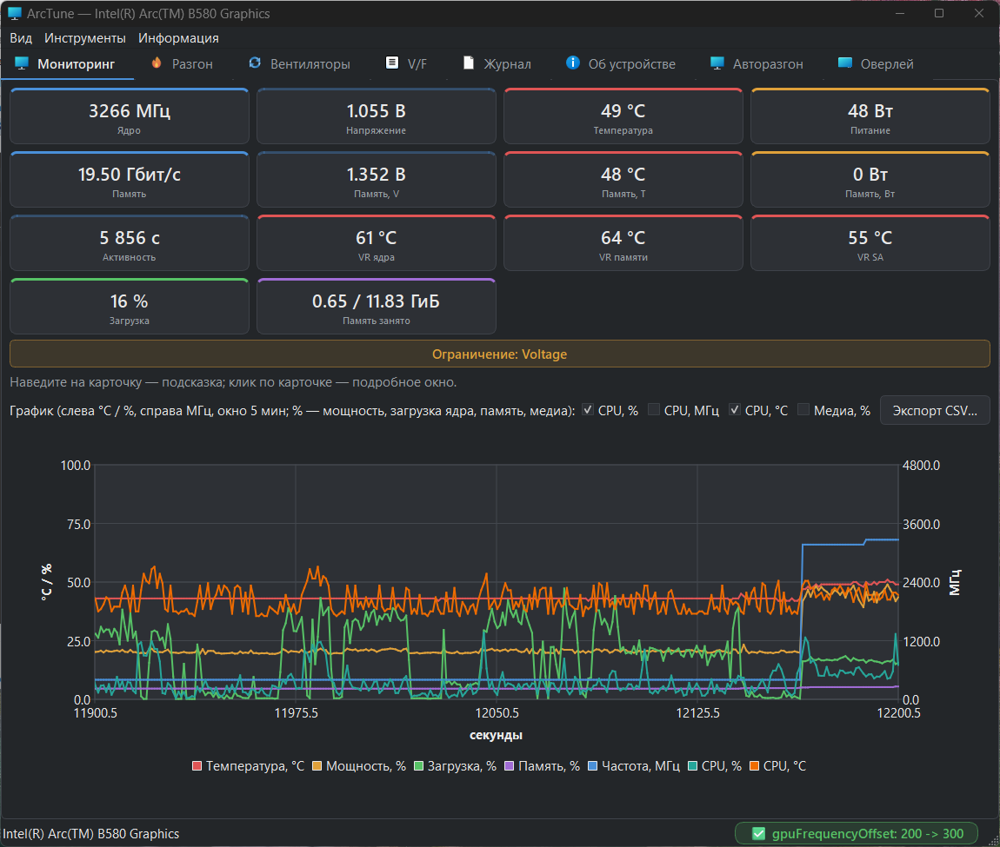
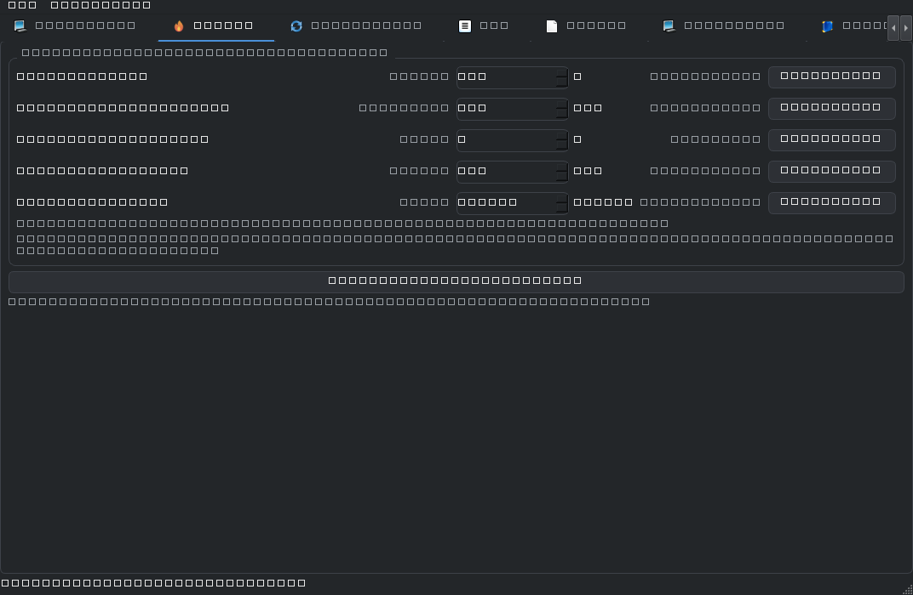
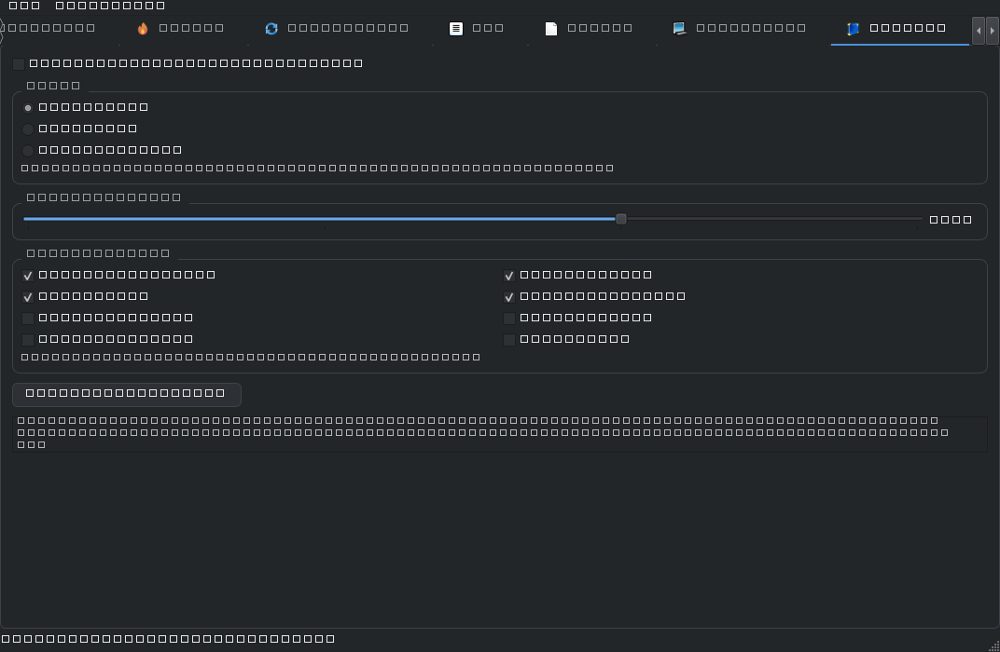
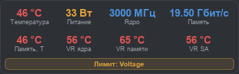

# ArcTune

English | [Русский](README.md)

Python wrapper over **IGCL (Intel Graphics Control Library)** for monitoring and
overclocking discrete **Intel Arc** graphics cards (tested on **Arc B580 / Battlemage**).

The project exposes the telemetry and overclocking knobs that ship with Intel Graphics
Software as code: power limit, core voltage/frequency, memory speed, V/F curve, and fan
RPM lock — plus an automatic search for a stable operating point.

> ⚠️ **Warning.** Overclocking and changing GPU limits is at your own risk.
> This project is not affiliated with Intel. Using it may void the warranty and, if
> abused, lead to instability or hardware damage. Read [docs/safety.md](docs/safety.md)
> (**in Russian**) **before** changing any setting.

---

## Status

| | |
|---|---|
| Stage | 🚧 **Alpha / work in progress** |
| Platform | Windows 10/11 x64 |
| Hardware | Discrete Intel Arc, tested on B580 |
| Driver | Intel Arc Graphics 32.0.101.9xxx+ |
| License | MIT |

Implemented and verified on a live B580:

- ✅ **Read-only telemetry** — sensors, throttle reasons, fans, V/F curve
- ✅ **Settings writes** — power limit / frequency / voltage / temperature / memory,
  with two-level validation and rollback
- ✅ **V/F curve** — CSV export and validated writes
- ✅ **Automatic stable-point search** (`autofind` / the "AutoTune" tab) — a shared
  `autotune/engine.py` engine for both CLI and GUI, guaranteed rollback to the last
  stable value, and a watchdog during the search (TDR, frozen telemetry, critical temp)
- ✅ **Journal + rollback**, telemetry export to CSV. After `reset --oc` the previous
  rollback targets are no longer valid: history remains, but the old overclock is not
  restored
- ✅ **GUI (PySide6)** — 7 tabs (monitoring, overclock, fans, V/F, journal, auto-tune,
  overlay) with charts and write confirmations; a standalone `arctune-gui.exe`
- ✅ **On-screen overlay (HUD)** — always-on-top telemetry over games/benchmarks with
  its own settings tab, 3 layouts, and a custom metric selection

Next up: an internal stress loader and a software fan curve (see
[ROADMAP](docs/roadmap.md)).

---

## Supported devices

An honest account of what is verified and what is not (a project invariant is
never to present the unverified as confirmed):

| Device | Status |
|---|---|
| **Intel Arc B580** (0xE20B) | ✅ Verified on live hardware: caps are fixed (power 50…120%, memory 19…22 Gbps at a 20 Gbps nominal, V/F curve 600…1250 mV / 300…3300 MHz) |
| **Other discrete Arc** (A770/A750, etc.) | ⚠️ Writes work through the driver's honest min/max/step (IGCL), but are **not verified** by this project — marked "not verified" in CLI/GUI. Use at your own risk; the driver will not let you exceed the hardware limit |
| **Integrated graphics (iGPU)** | ❌ Not supported: IGCL does not expose it at all — both shipped DLLs (iigd_dch and iigd_dch_d) see only the discrete card |

Verified on a B580 with driver 32.0.101.9150. For non-B580 cards there is no
project level-1 cap — the upper bound is set by the driver; rollback and
journaling behave identically for all cards.

---

## Preview

<p align="center">
  
  
</p>
<p align="center">
  
  
</p>

---

## How it works

Intel Graphics Software drives Arc overclocking through the native `IGCL.dll`
(public Intel API, header `igcl_api.h`). On top of it sits a .NET wrapper,
`IntelGraphicsSoftware.Wrapper.IGCL.dll`. We call `IGCL.dll` directly via `ctypes`,
bypassing the Intel GUI (our own GUI is a thin client over the same modules).

```
┌─────────────────────────────┐
│   ArcTune (Python)          │  ← this project
│   ctypes → IGCL.dll         │
├─────────────────────────────┤
│   IGCL.dll                  │  public Intel API (ctl* functions)
├─────────────────────────────┤
│   igdkmdnd64.sys            │  Arc kernel driver (B580)
└─────────────────────────────┘
```

The full list of used functions and structures is in
[docs/igcl-api.md](docs/igcl-api.md) (Russian).

---

## Quick start

```powershell
# 1. Clone and enter the folder
git clone https://github.com/dosermen/arctune.git
cd arctune

# 2. Create a virtual environment
python -m venv .venv
.venv\Scripts\Activate.ps1

# 3. Install dependencies
pip install -e ".[dev]"

# 4. Check that the driver and IGCL are visible
python -m arctuner doctor

# 5. Read telemetry (read-only, safe)
python -m arctuner telemetry
```

Details — in [docs/development.md](docs/development.md) (Russian).

### GUI (optional extra)

```powershell
pip install -e ".[gui]"        # installs PySide6
python -m arctuner.gui.main    # or the arctune-gui command
```

The GUI is read-only by default: every write requires a confirmation dialog, and the
values themselves are validated by the same `tuner.py` code the CLI uses. Power above
120% is never allowed anywhere — that is the hardware ceiling. Memory in the CLI:
`set --vram-speed` above 20 Gbps requires `--force`; in the GUI you can pick up to
22 Gbps (the maximum the B580 driver declares), but 21–22 only after a separate warning
and confirmation. Real-world experience: 21 Gbps works, 22 may be rejected by the driver.

Fans on B580: the driver only supports FIXED mode (RPM lock); there is no software
"temperature → speed" curve yet. It stays on the roadmap (see
[ROADMAP](docs/roadmap.md)).

Interface language: **View → Language: Русский / English** — the choice is saved to
`~/.arctune/language` and applied after a restart (same as the scale); right after
switching, a dialog offers to restart the application. The CLI reads
the same file, so the switcher also applies to the command line.

If the text is too small for your monitor: **View → 125 / 150 / 175 / 200 %**
(the scale is saved and applied after a restart — there is also
"Restart application" in the same menu).

### Building the exe

```powershell
pip install -e ".[build]"
pyinstaller --clean --noconfirm packaging/arctune.spec     # -> dist/arctune.exe (CLI)
pyinstaller --clean --noconfirm packaging/arctune-gui.spec # -> dist/arctune-gui.exe (GUI)
```

Portable `arctune.exe` (~9 MB) and `arctune-gui.exe` (~48 MB) run without Python on
the target machine — see [docs/building.md](docs/building.md) (Russian).

---

## Project layout

```
.
├── src/arctuner/
│   ├── igcl/            # low-level IGCL wrapper (ctypes)
│   │   ├── loader.py    #   loading IntelControlLib.dll/ControlLib.dll, symbol lookup
│   │   ├── types.py     #   C structs (_ctl_*_t) and enums (per igcl_api.h)
│   │   └── api.py       #   Python ctl* functions + error translation
│   ├── telemetry.py     # sensor reads (V, MHz, °C, %, throttle reasons)
│   ├── tuner.py         # settings writes (two-level validation)
│   ├── logbook.py       # change journal + rollback computation (JSONL)
│   ├── replay.py        # incident replay: telemetry ring buffer (read-only)
│   ├── autofind.py      # legacy autofind API (compatibility + tests)
│   ├── autotune/        # shared auto-tune engine for CLI and GUI
│   │   ├── engine.py    #   adaptive search, snapping to the IGCL grid, rollback
│   │   ├── loader.py    #   load check and external stress process
│   │   ├── watchdog.py  #   TDR / frozen telemetry / critical temperature
│   │   └── profiles.py  #   JSON search profiles
│   ├── context.py       # shared IGCL session + writes via tuner.py (CLI and GUI)
│   ├── gui/             # PySide6 GUI (extra `gui`, optional)
│   │   ├── window.py    #   main window: tabs, poll timer, signal wiring
│   │   ├── worker.py    #   GpuWorker: all IGCL calls in a dedicated QThread
│   │   ├── context.py   #   GpuContext re-export (import compatibility)
│   │   ├── charts.py    #   live chart and V/F chart (QtCharts)
│   │   ├── widgets.py   #   metric cards and the write-confirmation dialog
│   │   ├── tabs/        #   monitoring/overclock/fans/V-F/journal/auto-tune/overlay
│   │   └── main.py      #   `arctune-gui` entry point
│   └── cli.py           # command line
├── tests/               # tests (unit + hardware + offscreen GUI)
├── packaging/           # PyInstaller specs (CLI and GUI)
├── docs/                # documentation (Russian)
└── examples/            # usage examples
```

---

## Commands

```powershell
python -m arctuner --version           # package version
python -m arctuner doctor              # driver/IGCL check (exit code 1 — required functions missing)
python -m arctuner telemetry           # sensor snapshot + throttle reasons
python -m arctuner telemetry --csv out.csv   # + save the snapshot to CSV
python -m arctuner telemetry -w 1      # watch once per second
python -m arctuner telemetry --replay  # snapshot buffer + dump on counter reset/Ctrl+C
python -m arctuner status              # overclock item ranges (min/max/step)
python -m arctuner info                # PCIe/ReBAR, ECC, firmware, fan modes
python -m arctuner fans                # fan speeds/properties
python -m arctuner vf                  # V/F curve (read)
python -m arctuner vf --csv vf.csv     # export the V/F curve to CSV
python -m arctuner log                 # settings change history

# ⚠️ below — writes (they change the card and require confirmation):
python -m arctuner set --power-limit 110    # power limit, %
python -m arctuner set --vram-speed 20      # memory, Gbps (≤20 without --force; 21–22 with --force)
python -m arctuner vf --apply vf.csv        # write a V/F curve (validated)
python -m arctuner fans --set 1500          # lock fans, RPM
python -m arctuner autofind                 # frequency search (default; --mode undervolt)
python -m arctuner log --rollback           # roll back to the journal's initial values (not after reset)
python -m arctuner reset --oc --fans        # reset overclock + fans to auto
```

---

## Documentation

| Document | What's inside |
|---|---|
| [docs/safety.md](docs/safety.md) | **Safety rules. Read first.** (Russian) |
| [docs/architecture.md](docs/architecture.md) | Architecture, layers, design decisions (Russian) |
| [docs/igcl-api.md](docs/igcl-api.md) | Reverse-engineered IGCL API: functions, structs, fields (Russian) |
| [docs/overclocking.md](docs/overclocking.md) | Arc B580 overclocking methodology (Russian) |
| [docs/development.md](docs/development.md) | Environment setup, running, tests (Russian) |
| [docs/building.md](docs/building.md) | Building the portable `arctune.exe` (Russian) |
| [docs/roadmap.md](docs/roadmap.md) | Plans and what's already done (Russian) |
| [CONTRIBUTING.md](CONTRIBUTING.md) | Contribution rules and code style (Russian) |

---

## What the project does **not** do

An honest list of the boundaries, so you don't waste your time:

- **It does not change memory timings (straps).** They are applied by the GPU firmware
  during memory training. IGCL does not expose timings in any API version.
- **It does not flash vBIOS.** There are no modified vBIOS images with a higher limit
  for B580.
- **It does not bypass the hardware power limit.** The ~226 W limit (120% of 190 W) is
  measured by the shunt on the board; software cannot lift it (see
  [overclocking.md](docs/overclocking.md)).

---

## License

MIT — see [LICENSE](LICENSE).
