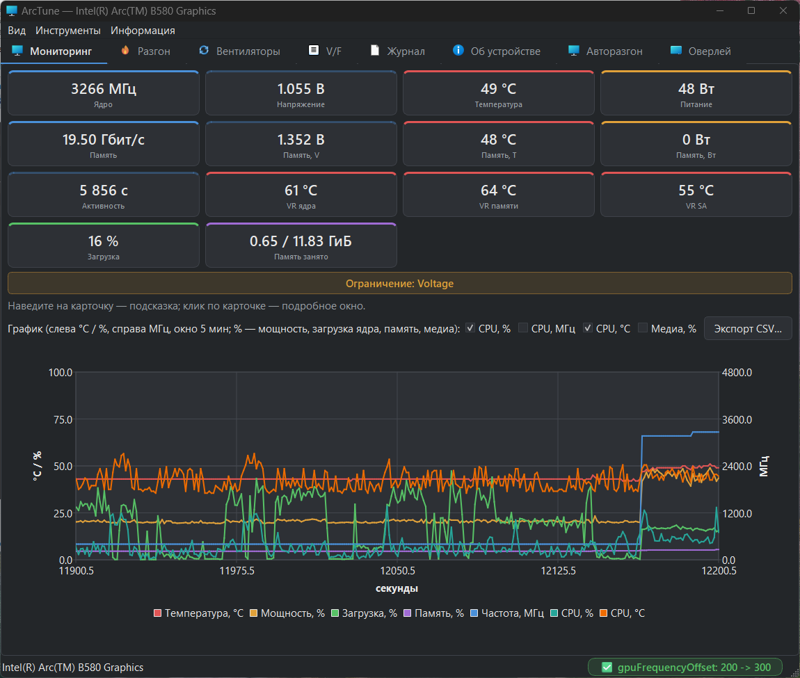
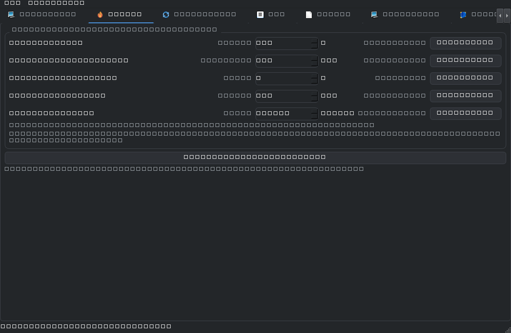
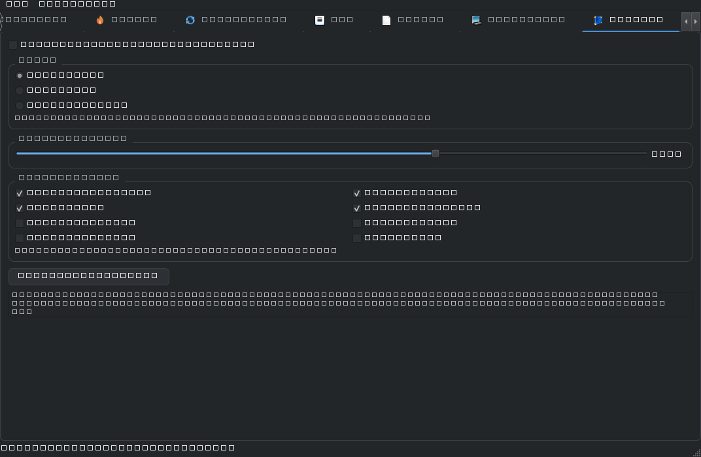
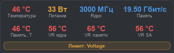

# ArcTune

Русский | [English](README.en.md)

Python-обёртка над **IGCL (Intel Graphics Control Library)** для мониторинга и разгона
дискретных видеокарт **Intel Arc** (проверено на **Arc B580 / Battlemage**).

Проект даёт программный доступ к телеметрии и настройкам разгона, которые есть в
Intel Graphics Software, но из кода: лимит питания, напряжение/частота ядра, скорость
памяти, кривая V/F и фиксация скорости вентиляторов — плюс автоматический поиск
стабильной точки.

> ⚠️ **Предупреждение.** Разгон и изменение лимитов видеокарты — на ваш страх и риск.
> Проект не аффилирован с Intel. Использование может аннулировать гарантию и, при
> злоупотреблении, привести к нестабильности или повреждению железа. Читайте
> [docs/safety.md](docs/safety.md) **до** любых изменений настроек.

---

## Статус

| | |
|---|---|
| Стадия | 🚧 **Alpha / в разработке** |
| Платформа | Windows 10/11 x64 |
| Железо | Intel Arc (дискретная), проверяется на B580 |
| Драйвер | Intel Arc Graphics 32.0.101.9xxx+ |
| Лицензия | MIT |

Сейчас реализовано и проверено на живой B580:

- ✅ **Read-only телеметрия** — датчики, причины ограничения, вентиляторы, кривая V/F
- ✅ **Запись настроек** — лимит питания / частота / напряжение / температура / память,
  с двухуровневой проверкой и откатом
- ✅ **Кривая V/F** — экспорт в CSV и валидированная запись
- ✅ **Автопоиск стабильной точки** (`autofind` / вкладка «Авторазгон») — общий
  движок `autotune/engine.py` для CLI и GUI, гарантия отката к последнему стабильному
  значению, watchdog во время поиска (TDR, заморозка телеметрии, аварийная температура)
- ✅ **Журнал + откат**, экспорт телеметрии в CSV. После `reset --oc` старые цели
  отката недействительны: история остаётся, но прежний разгон не возвращается
- ✅ **GUI (PySide6)** — 8 вкладок (мониторинг, разгон, вентиляторы, V/F, журнал,
  об устройстве, авторазгон, оверлей) с графиками и подтверждениями записи; отдельный `arctune-gui.exe`
- ✅ **CPU-телеметрия в GUI** — загрузка и частота через psutil, температура ядер
  через read-only shared memory Core Temp; серии графика и ячейки оверлея выбираются отдельно.
- ✅ **Оверлей поверх окон** — HUD с телеметрией поверх игр/бенчмарков: 3 макета,
  свой набор метрик, непрозрачность; настройки — во вкладке «Оверлей», меню «Вид»
  и правом клике по HUD

Дальше — внутренний стресс-нагрузчик и софт-кривая вентилятора (см.
[ROADMAP](docs/roadmap.md)).

---

## Поддержка устройств

Честно о том, что проверено, а что нет (инвариант проекта — не выдавать
непроверенное за подтверждённое):

| Устройство | Статус |
|---|---|
| **Intel Arc B580** (0xE20B) | ✅ Проверено на живом железе: потолки зафиксированы (питание 50…120%, память 19…22 Гбит/с при номинале 20, кривая V/F 600…1250 мВ / 300…3300 МГц) |
| **Прочие дискретные Arc** (A770/A750 и т.п.) | ⚠️ Запись работает через честные min/max/step из драйвера (IGCL), но проектом **не проверена** — в CLI/GUI помечается «не проверено». Используйте на свой страх; драйвер не даст выйти за аппаратный предел |
| **Встроенная графика (iGPU)** | ❌ Не поддерживается: IGCL её не отдаёт вовсе — обе поставляемые DLL (iigd_dch и iigd_dch_d) видят только дискретную карту |

Проверено на B580 с драйвером 32.0.101.9150. Для не-B580 карт уровнь-1
потолков проекта нет — верх определяет сам драйвер; откат и журналирование
работают одинаково для всех карт.

---

## Превью

<p align="center">
  
  
</p>
<p align="center">
  
  
</p>

---

## Как это работает

Intel Graphics Software управляет разгоном Arc через нативную библиотеку `IGCL.dll`
(публичный API Intel, header `igcl_api.h`). Слой выше — .NET-обёртка
`IntelGraphicsSoftware.Wrapper.IGCL.dll`. Мы обращаемся к `IGCL.dll` напрямую через
`ctypes`, минуя GUI Intel (наш собственный GUI — тонкий клиент поверх тех же модулей).

```
┌─────────────────────────────┐
│   ArcTune (Python)          │  ← этот проект
│   ctypes → IGCL.dll         │
├─────────────────────────────┤
│   IGCL.dll                  │  публичный API Intel (ctl* функции)
├─────────────────────────────┤
│   igdkmdnd64.sys            │  ядерный драйвер Arc (B580)
└─────────────────────────────┘
```

Полный список задействованных функций и структур — в [docs/igcl-api.md](docs/igcl-api.md).

---

## Быстрый старт

```powershell
# 1. Клонируйте и войдите в папку
git clone https://github.com/dosermen/arctune.git
cd arctune

# 2. Создайте виртуальное окружение
python -m venv .venv
.venv\Scripts\Activate.ps1

# 3. Установите зависимости
pip install -e ".[dev]"

# 4. Проверьте, что драйвер и IGCL видны
python -m arctuner doctor

# 5. Прочитать телеметрию (read-only, безопасно)
python -m arctuner telemetry
```

Подробнее — в [docs/development.md](docs/development.md).

### GUI (необязательный extra)

```powershell
pip install -e ".[gui]"        # ставит PySide6 и psutil для CPU-телеметрии
python -m arctuner.gui.main    # или команда arctune-gui
```

GUI — read-only по умолчанию: любая запись требует диалога подтверждения, а сами
значения проверяются тем же кодом `tuner.py`, что и в CLI. Питание выше 120% не
разрешается нигде — это аппаратный потолок. Память в CLI: `set --vram-speed` выше
20 Гбит/с только с `--force`; в GUI можно выбрать до 22 Гбит/с (максимум, который
декларирует драйвер B580), но 21–22 — только после отдельного предупреждения и
подтверждения. Живой опыт: 21 Гбит/с работает, 22 драйвер может отклонить.

Вентиляторы на B580: драйвер поддерживает только режим FIXED (фиксация RPM),
софт-кривой «температура → скорость» нет. Она остаётся в планах (см.
[ROADMAP](docs/roadmap.md)).

Язык интерфейса: меню **«Вид» → «Язык»: Русский / English** — выбор сохраняется
в файл `~/.arctune/language` и применяется после перезапуска (как и масштаб);
сразу после переключения диалог предлагает перезапустить приложение.
Тот же файл читает CLI, так что переключатель действует и на командную строку.

Если текст мелкий для вашего монитора: меню **«Вид» → 125 / 150 / 175 / 200 %**
(масштаб сохраняется и применяется после перезапуска — там же пункт
«Перезапустить приложение»).

### Сборка exe

```powershell
pip install -e ".[build,gui]"
pyinstaller --clean --noconfirm packaging/arctune.spec     # -> dist/arctune.exe (CLI)
pyinstaller --clean --noconfirm packaging/arctune-gui.spec # -> dist/arctune-gui.exe (GUI)
```

Переносимые `arctune.exe` (~9 МБ) и `arctune-gui.exe` (~48 МБ) без Python на
целевой машине — см. [docs/building.md](docs/building.md).

---

## Структура проекта

```
.
├── src/arctuner/
│   ├── igcl/            # низкоуровневая обёртка над IGCL (ctypes)
│   │   ├── loader.py    #   загрузка IntelControlLib.dll/ControlLib.dll, поиск функций
│   │   ├── types.py     #   C-структуры (_ctl_*_t) и enum'ы (по igcl_api.h)
│   │   └── api.py       #   Python-функции ctl* + преобразование ошибок
│   ├── telemetry.py     # чтение датчиков (В, МГц, °C, %, причины троттлинга)
│   ├── tuner.py         # установка настроек (write, двухуровневые проверки)
│   ├── logbook.py       # журнал изменений + расчёт отката (JSONL)
│   ├── replay.py        # реплей инцидента: кольцевой буфер телеметрии (read-only)
│   ├── autofind.py      # старый API autofind (модуль совместимости и тестов)
│   ├── autotune/        # общий движок авторазгона для CLI и GUI
│   │   ├── engine.py    #   адаптивный поиск, снаппинг к сетке IGCL, откат
│   │   ├── loader.py    #   проверка нагрузки и внешний стресс-процесс
│   │   ├── watchdog.py  #   TDR / заморозка телеметрии / аварийная температура
│   │   └── profiles.py  #   JSON-профили параметров поиска
│   ├── context.py       # общая сессия IGCL + запись через tuner.py (CLI и GUI)
│   ├── gui/             # GUI на PySide6 (extra `gui`, необязателен)
│   │   ├── window.py    #   главное окно: вкладки, таймер опроса, разводка сигналов
│   │   ├── worker.py    #   GpuWorker: все вызовы IGCL в отдельном QThread
│   │   ├── context.py   #   реэкспорт GpuContext (совместимость импортов)
│   │   ├── charts.py    #   живой график и кривая V/F (QtCharts)
│   │   ├── widgets.py   #   карточки метрик и диалог подтверждения записи
│   │   ├── tabs/        #   вкладки: мониторинг/разгон/вентиляторы/V/F/журнал/устройство/авторазгон/оверлей
│   │   │   └── autotune.py # вкладка «Авторазгон» (общий движок)
│   │   └── main.py      #   точка входа `arctune-gui`
│   └── cli.py           # командная строка
├── tests/               # тесты (unit + hardware + GUI offscreen)
├── packaging/           # PyInstaller-спецификации сборки exe (CLI и GUI)
├── docs/                # документация
└── examples/            # примеры использования
```

---

## Команды

```powershell
python -m arctuner --version           # версия пакета
python -m arctuner doctor              # проверка драйвера/IGCL (код 1 — нет обязательных функций)
python -m arctuner telemetry           # снимок датчиков + причины ограничения
python -m arctuner telemetry --csv out.csv   # + сохранить снимок в CSV
python -m arctuner telemetry -w 1      # наблюдать каждую секунду
python -m arctuner telemetry --replay  # буфер снимков + дамп при сбросе счётчика/Ctrl+C
python -m arctuner telemetry --load    # загрузка ядра (%) и память (занято/%) из IGCL
python -m arctuner status              # диапазоны пунктов разгона (min/max/step)
python -m arctuner state               # сверка текущих значений с журналом + версия драйвера
python -m arctuner info                # PCIe/ReBAR, ECC, прошивка, режимы вентиляторов
python -m arctuner fans                # скорость/свойства вентиляторов
python -m arctuner vf                  # кривая V/F (чтение)
python -m arctuner vf --csv vf.csv     # экспорт кривой V/F в CSV
python -m arctuner log                 # история изменений настроек

# ⚠️ ниже — запись (меняет карту, требует подтверждения):
python -m arctuner set --power-limit 110    # лимит питания, %
python -m arctuner set --vram-speed 20      # память, Гбит/с (≤20 без --force; 21–22 — с --force)
python -m arctuner vf --apply vf.csv        # записать кривую V/F (с валидацией)
python -m arctuner fans --set 1500          # зафиксировать вентиляторы, RPM
python -m arctuner autofind                 # поиск частоты (по умолчанию; --mode undervolt)
python -m arctuner log --rollback           # откат к исходным значениям журнала (не после reset)
python -m arctuner reset --oc --fans        # сброс OC + вентиляторы в авто
```

---

## Документация

| Документ | Что внутри |
|---|---|
| [docs/safety.md](docs/safety.md) | **Правила безопасности. Читать первым.** |
| [docs/architecture.md](docs/architecture.md) | Архитектура, слои, дизайн-решения |
| [docs/igcl-api.md](docs/igcl-api.md) | Разобранный IGCL API: функции, структуры, поля |
| [docs/overclocking.md](docs/overclocking.md) | Методика разгона Arc B580 и тонкости |
| [docs/development.md](docs/development.md) | Настройка окружения, запуск, тесты |
| [docs/building.md](docs/building.md) | Сборка переносимого `arctune.exe` (PyInstaller) |
| [docs/releasing.md](docs/releasing.md) | Подготовка версии и публикация GitHub Release |
| [docs/roadmap.md](docs/roadmap.md) | Планы и что уже сделано |
| [docs/adr/](docs/adr/) | Журнал архитектурных решений (ADR-0001…0006) |
| [CONTRIBUTING.md](CONTRIBUTING.md) | Правила участия и стиль кода |

---

## Чего проект **не** делает

Честно о границах возможного — чтобы не тратить ваше время впустую:

- **Не меняет тайминги памяти (страпы).** Их применяет firmware GPU при обучении памяти
  (memory training). IGCL не экспонирует тайминги ни в одной версии API.
- **Не прошивает vBIOS.** Для B580 модифицированных vBIOS с повышенным лимитом не существует.
- **Не обходит аппаратный лимит питания.** Лимит ~226 Вт (120% от 190 Вт) считается по шунту
  на плате; софт его не снимает (см. [overclocking.md](docs/overclocking.md)).

---

## Лицензия

MIT — см. [LICENSE](LICENSE).
